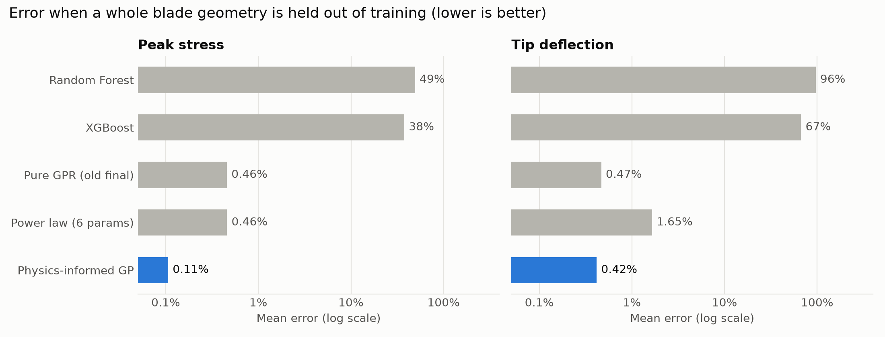
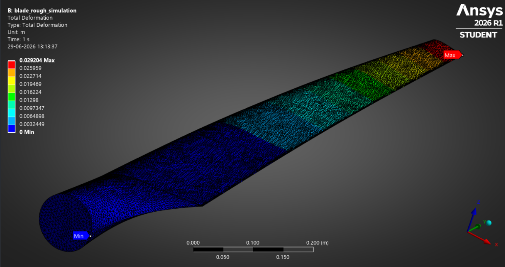
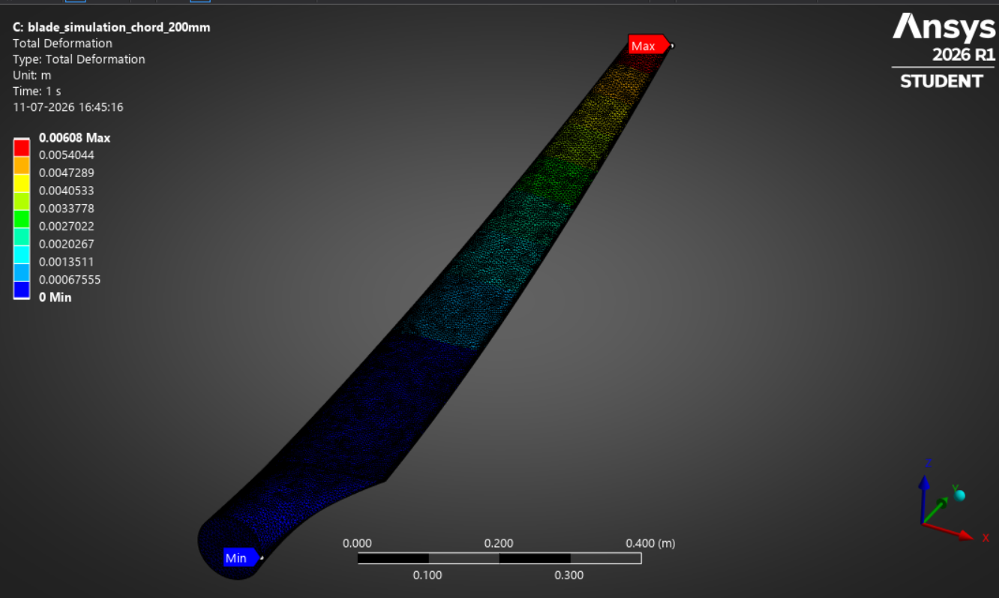

<div align="center">

# Wind Turbine Blade Stress & Deflection Predictor

**A physics-informed surrogate model, trained on 81 ANSYS simulations, that predicts the peak stress<br/>and tip deflection of a small wind turbine blade in milliseconds.**


<sub>Left: parametric NACA 4412 blade (Fusion 360). Right: von Mises stress under 1000 Pa (ANSYS Mechanical).</sub>

| **81** | **+0.2 % / −0.6 %** | **~5 ms** |
| :---: | :---: | :---: |
| ANSYS static-structural<br/>simulations | error on an independent<br/>validation simulation (stress / deflection) | per prediction, compared with<br/>minutes to hours per FEA run |

</div>

---

## Overview

A wind turbine blade behaves like a long, thin beam fixed at the hub. Under wind load, two quantities govern its structural design:

- **Tip deflection:** excessive bending can cause the blade to strike the tower.
- **Peak von Mises stress:** excessive stress leads to material failure.

Both are normally evaluated with finite element analysis (FEA), which requires a CAD update and a new simulation for every design change. This project builds a surrogate model that predicts both quantities from four inputs (**blade length, root chord, material and wind pressure**) and validates it against simulations it was not trained on.


---

## Methodology

### 1. Blade geometry
The blade was modelled parametrically in Autodesk Fusion 360 using a **NACA 4412** airfoil.

- **Taper:** the chord decreases linearly from root to tip, reaching 30 % of the root chord at the tip. This reduces tip mass and the bending moment arm:
  $c(r) = C_{\text{root}} \left( 1 - 0.7 \frac{r}{L_{\text{blade}}} \right)$
- **Twist:** 14.0° at the root, 10.5° at 25 % span, 7.5° at 50 %, 4.7° at 75 % and 2.0° at the tip. These are typical small-turbine values and were not optimised with BEM theory.

<p align="center">
  
</p>

### 2. Simulation setup
- **Analysis type:** linear static structural (ANSYS Mechanical).
- **Boundary conditions:** fixed support at the hub attachment; uniform pressure applied to the underside of the blade.
- **Mesh:** 3 mm global element size, selected from a mesh study during setup (the study data is not included in this repository). Where 3 mm was computationally too expensive, a 5 mm element size was used.

<p align="center">
  
</p>

### 3. Design of experiments
A full $3^4$ factorial design: every combination of three levels of four inputs, giving **81 simulations**. Results are stored in [Dataset/simulation_matrix_updated_info.csv](Dataset/simulation_matrix_updated_info.csv).

| Input | Levels |
| :--- | :--- |
| Blade length | 0.8 · 1.2 · 1.6 m |
| Root chord | 150 · 200 · 300 mm |
| Pressure load | 500 · 1000 · 1500 Pa |
| Material (isotropic) | Aluminium alloy · Fiberglass · Carbon fiber |

| Material | Density | Young's modulus $E$ | Poisson's ratio $\nu$ |
| :--- | :---: | :---: | :---: |
| Aluminium alloy | 2700 kg/m³ | 69 GPa | 0.33 |
| Fiberglass | 1900 kg/m³ | 25 GPa | 0.22 |
| Carbon fiber | 1600 kg/m³ | 120 GPa | 0.28 |

---

## Results: Structural Scaling Behaviour

The simulations follow classical cantilever-beam theory. For a blade of length $L$ and root chord $c$ under pressure $P$, tip deflection $\delta$ and peak stress $\sigma$ scale as:

$$\delta \propto \frac{P \, L^4}{E \, c^3} \qquad\qquad \sigma \propto \frac{P \, L^2}{c^2}$$

In practical terms, doubling the blade length increases tip deflection by roughly 16× and stress by roughly 4×. The material's stiffness $E$ affects deflection but not stress.

Fitting this relationship to all 81 simulations recovers the theoretical exponents directly from the data:

| | Blade length | Root chord | Load |
| :--- | :---: | :---: | :---: |
| **Stress**, theory → fitted | 2 → **2.01** | −2 → **−2.01** | 1 → **1.00** |
| **Deflection**, theory → fitted | 4 → **3.92** | −3 → **−2.88** | 1 → **1.00** |

<p align="center">
  
</p>

The deflection exponents are slightly below the ideal values because short, wide blades (e.g. 0.8 m with a 300 mm chord) deviate from slender-beam behaviour. Doubling the chord from 150 to 300 mm reduces deflection by 7.1× at 0.8 m but by 7.6× at 1.6 m, against a theoretical 8×. The final model is designed to capture this systematic deviation (see [Final model](#final-model-physics-informed-gaussian-process)).

> **Effective size of the dataset.** In linear static FEA, every result is exactly proportional to load (confirmed in the data to 5 significant figures), and deflection is almost exactly proportional to $1/E$. The 81 simulations therefore contain **9 distinct blade geometries**, each with 9 largely predictable load and material variants. This has a direct consequence for how the models must be validated.

<details>
<summary><b>Beam theory: derivation and background</b></summary>

<br/>

The blade is treated as a tapered, twisted cantilever: fixed at the hub, free at the tip.

- **Bending moment:** $M(x) = \int_{x}^{L} q(r)(r - x) \, dr$, the sum of all load outboard of a section multiplied by its lever arm, where $q(r)$ is the line load along the span.
- **Bending stiffness ($E \cdot I$):** $E$ is Young's modulus; $I$, the second moment of area, describes how material is distributed about the bending axis and increases with chord and thickness.
- **Bending stress:** $\sigma = \frac{M \cdot y}{I}$, where $y$ is the distance from the neutral axis; stress is highest at the outer surface.

**Origin of the exponents.** Under uniform pressure, total force scales with blade area, $F \propto P \cdot L \cdot c$. Because airfoil thickness is a fixed fraction of chord, $I \propto c^4$. Substituting into the cantilever equations gives $\delta \propto P L^4 / (E c^3)$ and $\sigma \propto P L^2 / c^2$.

**Effect of taper and twist.** All blades share the same taper ratio and the same twist profile relative to span fraction (geometric self-similarity). Taper and twist therefore change only the proportionality constant, not the exponents.

**Aerodynamic background (not modelled).**
- *Twist:* rotational speed increases toward the tip ($v = \Omega r$) while wind speed is constant, so the relative wind angle varies along the span. Blades are twisted so that each section operates near its optimal angle of attack.
- *Betz limit:* no turbine can extract more than 59.3 % of the wind's kinetic energy; wake rotation reduces the achievable value further. Blade Element Momentum (BEM) theory is the standard method for computing realistic aerodynamic loads.

This project does **not** use BEM: the wind load is simplified to a uniform pressure.

</details>

---

## Surrogate Modelling

### Validation strategy
An initial Gaussian Process Regressor (GPR) achieved $R^2 = 1.0000$ on a random train/test split and under random 5-fold cross-validation. These scores overstate real accuracy. In a random split, the eight load and material variants of a held-out simulation's geometry remain in the training set, and because those variants are largely predictable, the model is not tested on a genuinely new design.

All models were therefore evaluated with three tests of increasing rigour:

1. **Random 5-fold cross-validation:** included for reference; optimistic for the reason above.
2. **Leave-one-geometry-out:** train on 8 blade geometries and predict all 9 simulations of the remaining one, repeated for each geometry.
3. **Independent off-grid simulation:** one additional ANSYS run (1.3 m, 180 mm, carbon fiber, 1200 Pa), with length, chord and load all between the training levels. This is the only fully independent test.

### Model comparison
All models use the same log-transformed target, so the comparison is like-for-like. Values are mean absolute percentage error, reproduced by `python compare_models.py`:

| Model | Random 5-fold (stress / defl.) | Leave-one-geometry-out (stress / defl.) | Off-grid ANSYS run (stress / defl.) |
| :--- | :---: | :---: | :---: |
| Random Forest | 10.96% / 38.93% | 49.11% / 96.20% | −42.2% / −48.6% |
| XGBoost | 1.21% / 23.00% | 37.63% / 66.91% | +3.2% / +3.3% |
| Pure GPR (previous final model) | 0.01% / 0.01% | 0.46% / 0.47% | +3.0% / +2.8% |
| Power law (6 parameters) | 0.34% / 1.05% | 0.46% / 1.65% | +0.4% / −0.9% |
| **Physics-informed GP (final)** | 0.03% / 0.03% | **0.11% / 0.42%** | **+0.2% / −0.6%** |

<p align="center">
  
</p>

**Key findings**
1. **Random splits understate error.** The pure GPR's random-split error (0.01 %) is about 300× smaller than its error on the independent simulation (~3 %).
2. **Tree-based models are unsuitable.** Random Forest and XGBoost produce piecewise-constant predictions and cannot generalise to an unseen geometry (40–100 % error), even with the log-transformed target.
3. **The physics baseline outperforms the pure GPR** on the independent simulation (+0.4 % / −0.9 % vs +3.0 % / +2.8 %), indicating that beam theory explains most of the variation.
4. **Combining physics and machine learning gives the best result** on both rigorous tests.

### Final model: physics-informed Gaussian Process
The final model is built in two stages:

1. **Physics stage:** a six-parameter power law, fitted in log space, captures the beam-theory scaling.
2. **Correction stage:** a Gaussian Process is trained only on the remaining log-residual, as a function of blade length, chord and material. This residual corresponds to the deviation from slender-beam behaviour described above. Load is excluded from this stage because the physics stage already captures it exactly.

This design offers three advantages:

- **Accuracy:** lowest error on both the leave-one-geometry-out test and the independent simulation.
- **Stable extrapolation:** away from the training data, the GP correction decays toward zero and predictions revert toward beam theory rather than drifting.
- **Interpretability:** the fitted exponents are reported during training and can be checked against theory.

### Independent validation

| | Final model | ANSYS | Error |
| :--- | :---: | :---: | :---: |
| Equivalent stress | 18.88 MPa | 18.85 MPa | +0.2 % |
| Tip deflection | 13.58 mm | 13.67 mm | −0.6 % |

<p align="center">
  
  
</p>

This is a single validation point and should be read as a confirmation, not a statistical guarantee. The leave-one-geometry-out results provide the broader evidence.

> **Uncertainty estimates.** Gaussian Processes can report predictive error bars; here they were several times narrower than the observed off-grid error, so the prediction tool does not display them. The validation table is the more reliable measure of model uncertainty.
>
> **Notebooks.** The notebooks in `Python/` document the development process (Random Forest → XGBoost → GPR) and report the original random-split metrics. `compare_models.py` is the authoritative source for model accuracy.

---

## Design Insights

The table shows how much each input changes the result across its full simulated range. Ratios are taken directly from the FEA data, with the other inputs held at 1.2 m length, 150 mm chord, carbon fiber and 1000 Pa.

| Rank | Design parameter | Stress change | Deflection change | Governing relationship |
| :---: | :--- | :---: | :---: | :--- |
| **1** | **Blade length** 0.8 → 1.6 m | 4.02× increase | 15.59× increase | Lever arm: $\delta \propto L^4$ |
| **2** | **Root chord** 150 → 300 mm | 4.02× decrease | 7.43× decrease | Stiffness: $I \propto c^4$ |
| **3** | **Material** fiberglass → carbon fiber | ≈1.00× (no effect) | 4.80× decrease | Deflection $\propto 1/E$; stress independent of $E$ |
| **4** | **Load** 500 → 1500 Pa | 3.00× increase | 3.00× increase | Linear elasticity |

- **Deflection is governed primarily by blade length.** Doubling the length increases tip deflection by about 16×. It can be reduced by increasing the root chord or using a stiffer material; carbon fiber deflects 4.8× less than fiberglass.
- **Material choice does not reduce stress.** Peak stress depends only on geometry and load, so stress must be controlled geometrically, through a shorter blade or a wider root chord (each about 4× across the tested range).

<p align="center">
  
  
</p>
<p align="center"><sub>Identical geometry and load: fiberglass (left) and carbon fiber (right).</sub></p>

---

## Usage

Requires **Python 3.10+**.

```bash
cd Wind_Turbine_Project
python -m venv .venv
.venv\Scripts\activate            # Windows   (macOS/Linux: source .venv/bin/activate)
pip install -r requirements.txt

python train_and_save_models.py   # train the final models -> models/ (~1 min)
python predict.py                 # interactive predictions
```

| Command | Purpose |
| :--- | :--- |
| `python compare_models.py` | Reproduces the model comparison table and figure (~2 min) |
| `python tests/test_models.py` | Runs the test suite |

<details>
<summary><b>Example session</b> (independent validation case, not part of the training data)</summary>

```text
======================================================================
                 Wind Turbine Blade Prediction System
======================================================================

Loading trained models...
✓ Models loaded successfully!

Please enter the blade parameters:

Blade Length (m): 1.3
Chord Length (mm): 180

Available materials: Aluminium, Fiberglass, Carbon fiber
Material: Carbon fiber
Applied Load (Pa): 1200

Input Parameters:
├─ Blade Length  : 1.30 m
├─ Chord Length  : 180 mm
├─ Material      : Carbon fiber
└─ Applied Load  : 1200 Pa

Computing predictions...

──────────────────────────────────────────────────────────────────────
Prediction Results:
──────────────────────────────────────────────────────────────────────

  Maximum Equivalent Stress:
    18.88 MPa

  Maximum Deflection:
    13.58 mm

──────────────────────────────────────────────────────────────────────
```

</details>

**Valid input range:** 0.8–1.6 m blade length, 150–300 mm root chord, 500–1500 Pa load. Inputs outside this range still return a prediction, accompanied by a warning that the result is an unverified extrapolation.

---

## Limitations and Future Work

**Simulation fidelity**
- **Simplified loading:** a uniform static pressure replaces real aerodynamic loads; rotation, centrifugal force, gravity and fatigue cycles are not modelled, and BEM is not used.
- **Isotropic materials:** composites are modelled as isotropic solids rather than layered ply laminates.
- **Mesh sensitivity of peak stress:** peak stress occurs at the blade–hub junction, adjacent to the fixed support, where values can continue to rise with mesh refinement. The mesh study data is not included, and some runs used a 5 mm mesh instead of 3 mm.
- **No fluid–structure interaction:** blade deflection does not feed back into the aerodynamic load.
- **Linear, small-deflection analysis:** nonlinear effects at the extremes of the design range are not captured.

**Data and model**
- **Limited geometric coverage:** the dataset contains 9 distinct geometries (3 lengths × 3 chords). Taper ratio and thickness were not varied.
- **Single independent validation point:** additional off-grid simulations, ideally from a space-filling design such as Latin hypercube sampling, would provide a stronger accuracy estimate.
- **Restricted validity:** predictions are supported only within the simulated range and for the three materials tested.
- **Reproducibility of the FEA:** the ANSYS Workbench results folder is too large for the repository, so the simulations cannot be reopened from `ANSYS/`.
- **No physical validation:** the model is validated against ANSYS only, not against a physical blade.

**Future work:** a space-filling simulation campaign that also varies taper and thickness, a mesh-convergence study at the peak-stress location, and BEM-derived loading in place of uniform pressure.

---

<details>
<summary><b>Repository structure</b></summary>

```
├── ANSYS/                    # ANSYS Workbench project file (results folder not included)
├── CAD/                      # STEP files for the 9 blade geometries and early prototypes
├── Dataset/                  # 81-simulation dataset (CSV)
├── Notes/                    # Weekly engineering notes
├── Python/                   # Jupyter notebooks: EDA, model development, sensitivity analysis
├── Visualisations/           # ANSYS contour plots and analysis figures
├── src/                      # Core package: data loading, models, evaluation, prediction
├── tests/                    # Test suite (python tests/test_models.py)
├── compare_models.py         # Reproduces all accuracy figures in this README
├── train_and_save_models.py  # Trains the final models -> models/ (generated locally)
├── predict.py                # Interactive command-line tool
└── requirements.txt
```

</details>

## License

Released under the [MIT License](LICENSE).

<p align="center"><sub>Author: Anish Gangavaram</sub></p>
