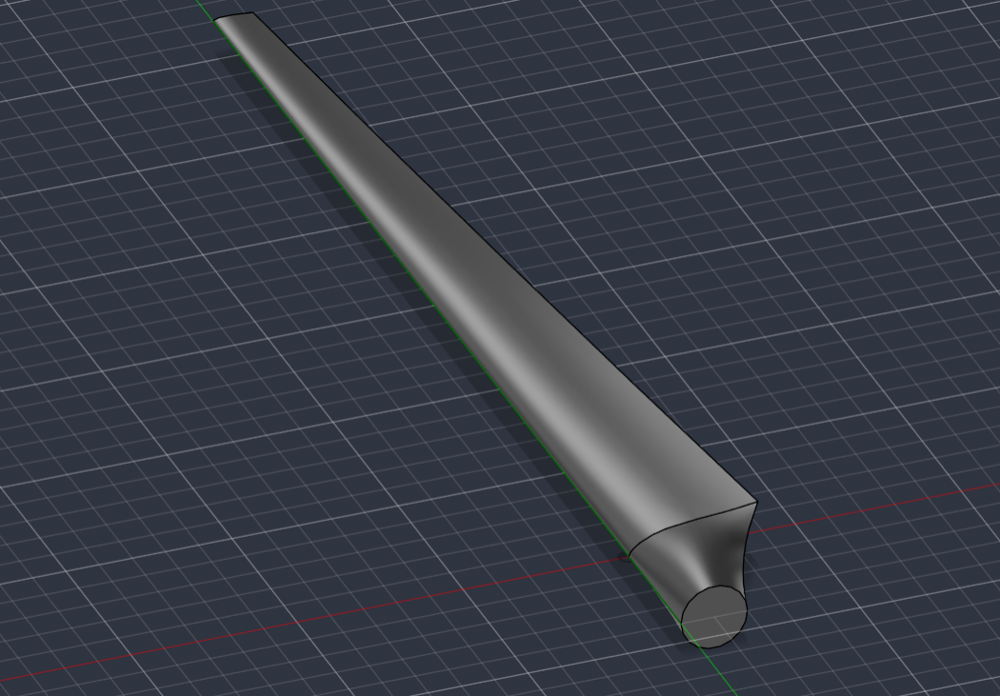
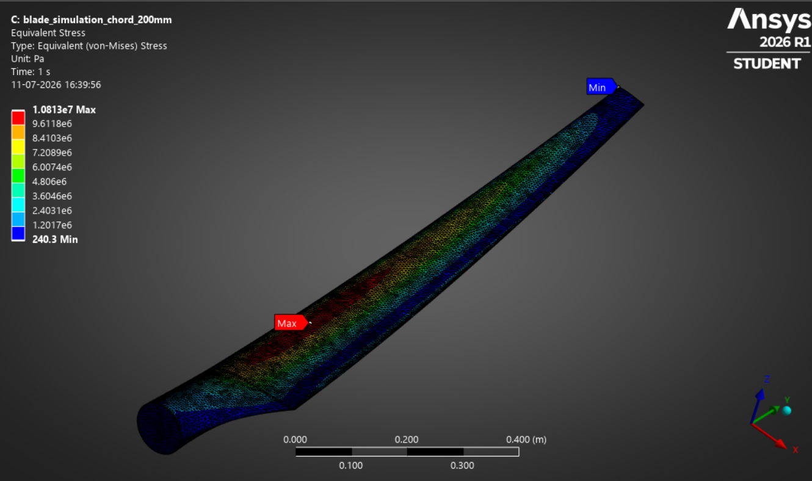
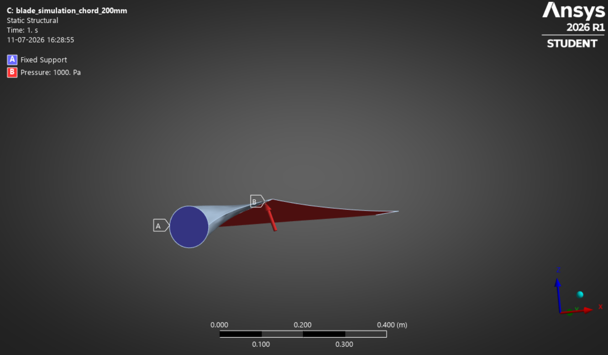
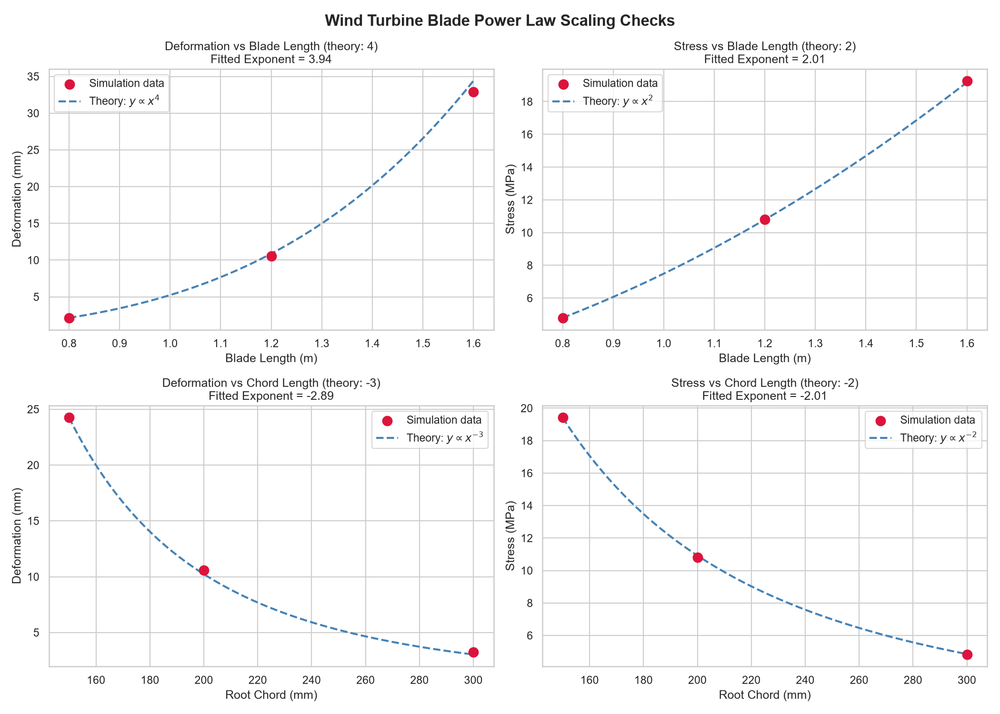
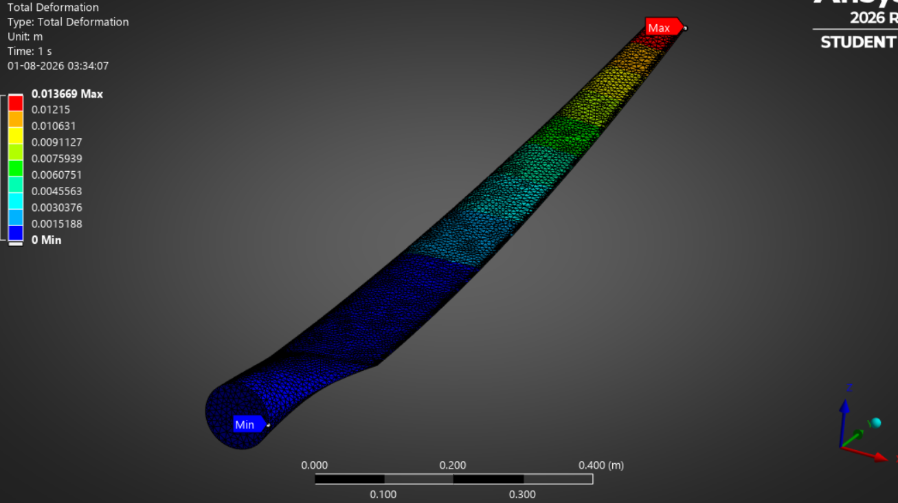
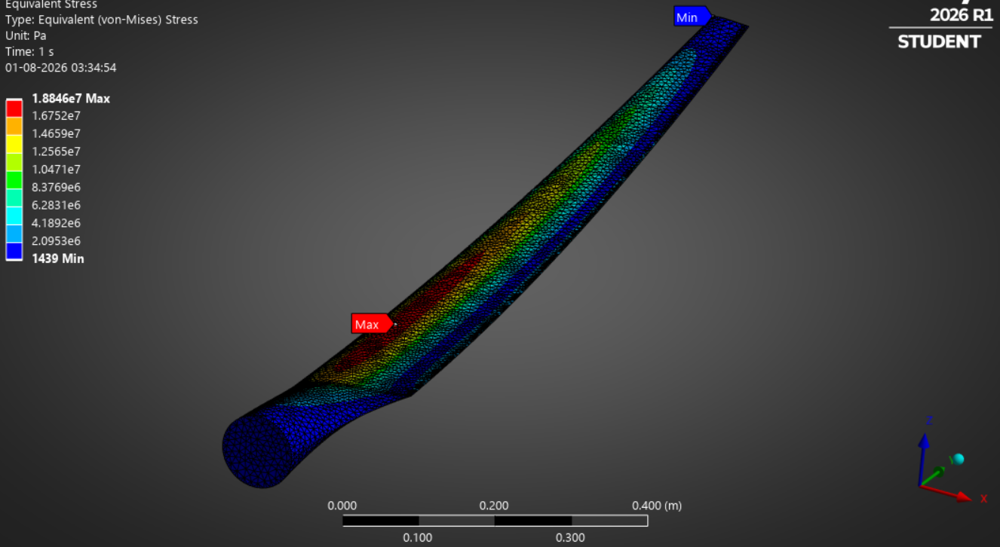

<div align="center">

# Wind Turbine Blade Stress & Deflection Predictor

**From a CAD model, to 81 ANSYS simulations, to a physics-informed ML model<br/>that predicts how much a blade bends and how hard it is stressed, in milliseconds.**





<sub>Left: the parametric NACA 4412 blade in Fusion 360. Right: von Mises stress from ANSYS under 1000 Pa.</sub>

| **81** | **+0.2 % / −0.6 %** | **milliseconds** |
| :---: | :---: | :---: |
| ANSYS simulations | error on a brand-new simulation<br/>(stress / deflection) | per prediction, instead of<br/>minutes to hours of FEA |

</div>

---

## The question

A wind turbine blade is a long, thin wing fixed at one end. When the wind pushes on it, two things matter: **how far the tip bends** (bend too far and it can strike the tower) and **how hard the material is stressed** (too much and it fails).

Engineers check both with finite element analysis (FEA), but every new design means editing CAD and re-running a simulation that takes minutes to hours. I wanted to know: **can a model trained on a set of simulations answer instantly, and can I prove it's actually right?**

---

## What I built


### 1. The blade
A parametric blade in Autodesk Fusion 360, built from a **NACA 4412** airfoil:

- **Taper:** the chord shrinks linearly to 30 % at the tip, which keeps tip mass and the bending lever arm down. In formula form, $c(r) = C_{\text{root}} \left( 1 - 0.7 \frac{r}{L_{\text{blade}}} \right)$.
- **Twist:** 14.0° at the root → 10.5° → 7.5° → 4.7° → 2.0° at the tip (at 0, 25, 50, 75 and 100 % of the span). These are typical small-turbine values, not BEM-optimised.

<p align="center">
  
</p>

### 2. The simulation
- **Supports and load:** fixed support at the hub attachment, uniform pressure on the underside of the blade.
- **Mesh:** 3 mm global element size, chosen from a mesh study during setup (the study's raw data is not in this repo). A few runs where 3 mm was too slow used 5 mm instead.

<p align="center">
  
</p>

### 3. The dataset: 81 simulations
Every combination of 3 levels of 4 inputs (a full $3^4$ factorial), stored in [Dataset/simulation_matrix_updated_info.csv](Dataset/simulation_matrix_updated_info.csv):

| Input | Levels |
| :--- | :--- |
| Blade length | 0.8 · 1.2 · 1.6 m |
| Root chord | 150 · 200 · 300 mm |
| Pressure load | 500 · 1000 · 1500 Pa |
| Material (isotropic) | Aluminium alloy · Fiberglass · Carbon fiber |

| Material | Density | Young's modulus $E$ | Poisson's ratio $\nu$ |
| :--- | :---: | :---: | :---: |
| Aluminium alloy | 2700 kg/m³ | 69 GPa | 0.33 |
| Fiberglass | 1900 kg/m³ | 25 GPa | 0.22 |
| Carbon fiber | 1600 kg/m³ | 120 GPa | 0.28 |

---

## What the simulations showed

**Longer blades bend dramatically more; wider blades bend dramatically less.** That's exactly what textbook beam theory predicts. Treat the blade as a cantilever beam under pressure $P$, and the tip deflection $\delta$ and peak stress $\sigma$ scale as:

$$\delta \propto \frac{P \, L^4}{E \, c^3} \qquad\qquad \sigma \propto \frac{P \, L^2}{c^2}$$

In words: double the length and the tip bends about 16× more, while the stress rises about 4×. Stiffness $E$ affects bending but not stress.

Fitting that formula to all 81 runs recovers the theory straight from the data:

| | Blade length | Root chord | Load |
| :--- | :---: | :---: | :---: |
| **Stress**, theory → fitted | 2 → **2.01** | −2 → **−2.01** | 1 → **1.00** |
| **Deflection**, theory → fitted | 4 → **3.92** | −3 → **−2.88** | 1 → **1.00** |

<p align="center">
  
</p>

Deflection falls slightly short of the ideal exponents because short, wide blades (0.8 m with a 300 mm chord) are less like slender beams: going from 150 to 300 mm chord cuts deflection 7.1× at 0.8 m but 7.6× at 1.6 m (theory: 8×). Remember that small, systematic gap; it comes back later.

> **An honest note on the 81 runs.** In linear static FEA, every result is exactly proportional to load (the data confirms this to 5 significant figures), and deflection is almost exactly proportional to $1/E$. So the 81 runs are really **9 blade geometries**, each with 9 near-predictable load and material variants. That turns out to matter a lot for testing the models.

<details>
<summary><b>Show the beam theory behind it</b></summary>

<br/>

Structurally, the blade behaves like a tapered, twisted cantilever: fixed at the hub, free at the tip.

- **Bending moment:** $M(x) = \int_{x}^{L} q(r)(r - x) \, dr$. The moment at any point is the sum of all the load beyond it, times its lever arm. $q(r)$ is the line load along the span.
- **Bending stiffness ($E \cdot I$):** $E$ is the material's Young's modulus; $I$, the second moment of area, measures how much material sits far from the bending axis, and grows with chord and thickness.
- **Bending stress:** $\sigma = \frac{M \cdot y}{I}$. Stress is highest at the outer surface ($y$ is the distance from the neutral axis).

**Where the exponents come from.** Under uniform pressure, the total force scales with blade area, $F \propto P \cdot L \cdot c$. Because airfoil thickness is a fixed fraction of chord, $I \propto c^4$. Substituting into the cantilever formulas gives $\delta \propto P L^4 / (E c^3)$ and $\sigma \propto P L^2 / c^2$.

**Why taper and twist don't change them.** Every blade shares the same taper ratio and twist-vs-span-fraction profile (geometric self-similarity), so taper and twist only change the constant in front, not the exponents.

**Background: aerodynamics (context, not modelled).**
- *Twist:* rotational speed grows toward the tip ($v = \Omega r$) while wind speed stays constant, so the relative wind angle changes along the span. Blades are twisted root-to-tip so each section sees a near-optimal angle of attack.
- *Betz limit:* no turbine can extract more than 59.3 % of the wind's kinetic energy; wake rotation lowers the real figure further. Blade Element Momentum (BEM) theory is the standard tool for computing real aerodynamic loads.

This project does **not** run BEM: the wind load is simplified to a uniform pressure on the blade.

</details>

---

## The ML twist: when "perfect" wasn't

### The trap
My first models looked perfect. A Gaussian Process Regressor (GPR) scored $R^2 = 1.0000$ on a random train/test split and in random 5-fold cross-validation.

Then I noticed the catch. In a random split, a held-out simulation's eight load/material "siblings" from the same geometry stay in the training set. Because load and material are nearly trivial to predict, the model never really gets tested on anything new.

### Three tests, from weakest to strongest
1. **Random 5-fold CV:** the flattering one.
2. **Hold out a whole geometry:** train on 8 blade shapes, predict all 9 runs of the 9th. Repeat for every shape.
3. **A brand-new ANSYS run:** one extra simulation (1.3 m, 180 mm, carbon fiber, 1200 Pa), off-grid in three variables at once. This is the only fully independent check.

Every model gets the same log-transformed target, so the comparison is like-for-like. Mean absolute percentage error, from `python compare_models.py`:

| Model | Random 5-fold (stress / defl.) | Hold out a geometry (stress / defl.) | Off-grid ANSYS run (stress / defl.) |
| :--- | :---: | :---: | :---: |
| Random Forest | 10.96% / 38.93% | 49.11% / 96.20% | −42.2% / −48.6% |
| XGBoost | 1.21% / 23.00% | 37.63% / 66.91% | +3.2% / +3.3% |
| Pure GPR (old final model) | 0.01% / 0.01% | 0.46% / 0.47% | +3.0% / +2.8% |
| Power law (6 parameters) | 0.34% / 1.05% | 0.46% / 1.65% | +0.4% / −0.9% |
| **Physics-informed GP (final)** | 0.03% / 0.03% | **0.11% / 0.42%** | **+0.2% / −0.6%** |

<p align="center">
  
</p>

### What I learned
1. **Random splits hid the real error.** The pure GPR's random-split error (0.01 %) was about 300× smaller than its error on the new ANSYS run (~3 %).
2. **Tree models can't do this job.** Random Forest and XGBoost predict piecewise-constant steps, so they cannot extrapolate to an unseen blade shape (40–100 % error), even with the log transform.
3. **A 6-parameter physics formula beat the pure GPR** on the new simulation (+0.4 % / −0.9 % vs +3.0 % / +2.8 %). The physics already explains almost everything.
4. **The best model combines both.**

### The final model: physics first, ML for the leftovers
The final model fits the beam-theory power law first, then trains a Gaussian Process only on the small leftover (the log-residual), as a function of blade length, chord and material. That leftover is the "short, wide blades aren't quite slender beams" gap from earlier. Load is left out of the GP because the physics already captures it exactly.

- **Accurate:** best on both honest tests.
- **Safe outside the data:** away from the training points the GP correction fades toward zero and the prediction leans on beam theory, instead of drifting the way a pure GPR does.
- **Interpretable:** the fitted exponents are printed when you train, and they can be checked against textbook theory.

### The final exam: a simulation the model has never seen

| | Final model | ANSYS ground truth | Error |
| :--- | :---: | :---: | :---: |
| Equivalent stress | 18.88 MPa | 18.85 MPa | +0.2 % |
| Tip deflection | 13.58 mm | 13.67 mm | −0.6 % |

<p align="center">
  
  
</p>

This is a single point, so treat it as a sanity check rather than a guarantee. The hold-out-a-geometry test above is the broader evidence.

> **About uncertainty:** a GP can report its own error bars, but here they came out several times narrower than the real off-grid error, so the tool doesn't display them. Judge model uncertainty from the validation table instead.
>
> **About the notebooks:** `Python/` documents the journey (Random Forest → XGBoost → GPR), and those notebooks still show the original random-split metrics. `compare_models.py` is the source of truth for accuracy.

---

## Design takeaways

How much each input changes the result across its full simulated range. These ratios are read straight from the FEA data, holding the others at 1.2 m length, 150 mm chord, carbon fiber, 1000 Pa:

| Rank | Design parameter | Stress change | Deflection change | Why |
| :---: | :--- | :---: | :---: | :--- |
| **1** | **Blade length** 0.8 → 1.6 m | 4.02× increase | 15.59× increase | Lever arm: $\delta \propto L^4$ |
| **2** | **Root chord** 150 → 300 mm | 4.02× decrease | 7.43× decrease | Stiffness: $I \propto c^4$ |
| **3** | **Material** fiberglass → carbon | ≈1.00× (no effect) | 4.80× decrease | Deflection $\propto 1/E$; stress doesn't depend on $E$ |
| **4** | **Load** 500 → 1500 Pa | 3.00× increase | 3.00× increase | Linear elasticity |

- **Deflection is dominated by blade length.** Doubling the length gives ~16× more tip deflection. To control it, widen the root chord or use a stiffer material: carbon fiber deflects 4.8× less than fiberglass.
- **Material doesn't reduce stress.** Peak stress is set by geometry and load alone, so stress problems have to be solved geometrically: a shorter blade or a wider root chord (each about 4× across the range).

<p align="center">
  
  
</p>
<p align="center"><sub>Same blade, same load: fiberglass (left) vs carbon fiber (right).</sub></p>

---

## Try it

Requires **Python 3.10+**.

```bash
cd Wind_Turbine_Project
python -m venv .venv
.venv\Scripts\activate            # Windows   (macOS/Linux: source .venv/bin/activate)
pip install -r requirements.txt

python train_and_save_models.py   # fit the final models -> models/ (~1 min)
python predict.py                 # interactive predictions
```

Two more commands: `python compare_models.py` reproduces the validation table and figure (~2 min), and `python tests/test_models.py` runs the checks.

<details>
<summary><b>Example run</b> (the off-grid validation case: this exact blade was never in the training data)</summary>

```text
======================================================================
                 Wind Turbine Blade Prediction System
======================================================================

Loading trained models...
✓ Models loaded successfully!

Please enter the blade parameters:

Blade Length (m): 1.3
Chord Length (mm): 180

Available materials: Aluminium, Fiberglass, Carbon fiber
Material: Carbon fiber
Applied Load (Pa): 1200

Input Parameters:
├─ Blade Length  : 1.30 m
├─ Chord Length  : 180 mm
├─ Material      : Carbon fiber
└─ Applied Load  : 1200 Pa

Computing predictions...

──────────────────────────────────────────────────────────────────────
Prediction Results:
──────────────────────────────────────────────────────────────────────

  Maximum Equivalent Stress:
    18.88 MPa

  Maximum Deflection:
    13.58 mm

──────────────────────────────────────────────────────────────────────
```

</details>

Inputs outside the simulated envelope (0.8–1.6 m, 150–300 mm, 500–1500 Pa) still get a prediction, but with a **warning**: no simulations back that region, so the result is an unverified extrapolation.

---

## Limitations & what I'd do next

**Simulation fidelity**
- **Simplified loading:** a uniform static pressure stands in for real aerodynamic loads (no BEM, no rotation, centrifugal, gravity or fatigue cycles).
- **Isotropic materials:** composites are modelled as isotropic solids, not as layered ply laminates.
- **Mesh-sensitive peak stress:** the peak sits at the blade–hub junction, next to the fixed support, where peak values can keep rising as the mesh is refined. The mesh-study data isn't included, and a few runs used 5 mm instead of 3 mm.
- **No fluid–structure interaction:** blade deflection doesn't feed back into the aerodynamics.
- **Small-deflection, linear analysis:** nonlinear effects at the extremes of the envelope aren't captured.

**Data & model**
- **9 real geometries:** load and material only scale results linearly, so blade-shape coverage is 3 lengths × 3 chords. Taper ratio and thickness were never varied.
- **One off-grid validation point:** more independent ANSYS runs (ideally space-filling, e.g. Latin hypercube) would give a far stronger accuracy estimate.
- **Valid inside the envelope only:** 0.8–1.6 m, 150–300 mm, 500–1500 Pa, three materials.
- **Not reproducible from the ANSYS file alone:** the Workbench results folder is too large for the repo.
- **Validated against ANSYS only**, never against a physical blade.

**Next:** space-filling simulations that also vary taper and thickness, a mesh-convergence table at the peak-stress location, and BEM-derived loads in place of uniform pressure.

---

<details>
<summary><b>Repository map</b></summary>

```
├── ANSYS/                    # ANSYS Workbench project file (solver results folder not included)
├── CAD/                      # STEP files for the 9 blade geometries + early prototypes
├── Dataset/                  # The 81-simulation dataset (CSV)
├── Notes/                    # Weekly engineering notes - the project diary
├── Python/                   # Jupyter notebooks: EDA, model experiments, sensitivity analysis
├── Visualisations/           # ANSYS contour plots and analysis figures
├── src/                      # Core package: data loading, models, evaluation, prediction
├── tests/                    # python tests/test_models.py
├── compare_models.py         # Reproduces every accuracy number in this README
├── train_and_save_models.py  # Trains the final models -> models/ (created locally, not committed)
├── predict.py                # Interactive CLI
└── requirements.txt
```

</details>

## License

Released under the [MIT License](LICENSE). Feel free to use, modify, and build on this work; just keep the copyright notice.

<p align="center"><sub>Built by Anish Gangavaram</sub></p>
